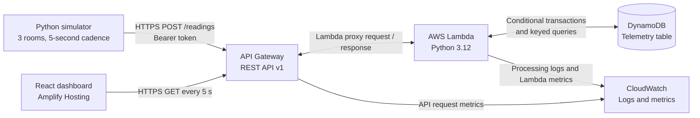

# EcoSync architecture

1. The simulator sends one timestamped reading per room every five seconds. It retries transient failures with the original timestamp. API Gateway passes requests to Lambda.
2. Lambda validates the token on writes, checks timestamp ordering, integrates energy, and applies anomaly rules. One DynamoDB transaction writes the new reading, room state, rollups and any alert update.
3. React retrieves latest readings, daily and half-hour aggregates, settings and alert history through the same API. Amplify serves the compiled frontend. CloudWatch receives processing outcomes and application errors.
4. Local mode routes simulator and React requests to the Python HTTP server and SQLite. Both modes use the same API contracts and calculation code. Demo history can be seeded only into SQLite.

## DynamoDB key design

| Partition key | Sort key | Record |
| --- | --- | --- |
| `ROOM#<id>` | `META` | Room information, last accepted reading, version and open alert |
| `ROOM#<id>` | `READING#<UTC timestamp>` | One raw reading |
| `ROOM#<id>` | `DAY#<IST date>` | Energy summed per local calendar day |
| `ROOM#<id>` | `SLOT#<UTC slot start>` | Energy and covered duration summed per half-hour |
| `ROOM#<id>` | `ALERT#<start timestamp>` | One alert and its recovery state |
| `SYSTEM` | `SETTINGS` | Tariff, emission factor, room thresholds and settings version |

DynamoDB can query a single room and a timestamp range using the composite primary key. Analytics reads at most 30 days of daily rollups per room, or up to 48 half-hour rollups per room for today's graph. Raw data stays available for reading history without being rescanned by each analytics refresh.

The latest timestamp doubles as a room version. Conflicting writes retry against fresh room state, and repeated readings return the saved result without adding energy twice. The same room key and transaction design is used by the SQLite adapter. Estimates use the current configuration and energy measured over covered intervals.
